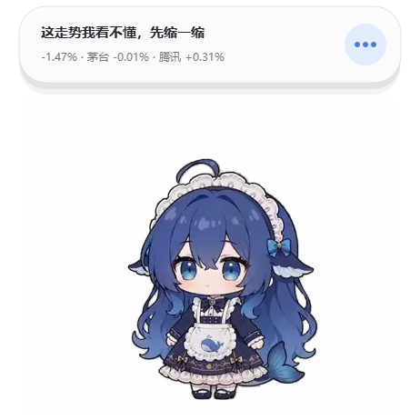
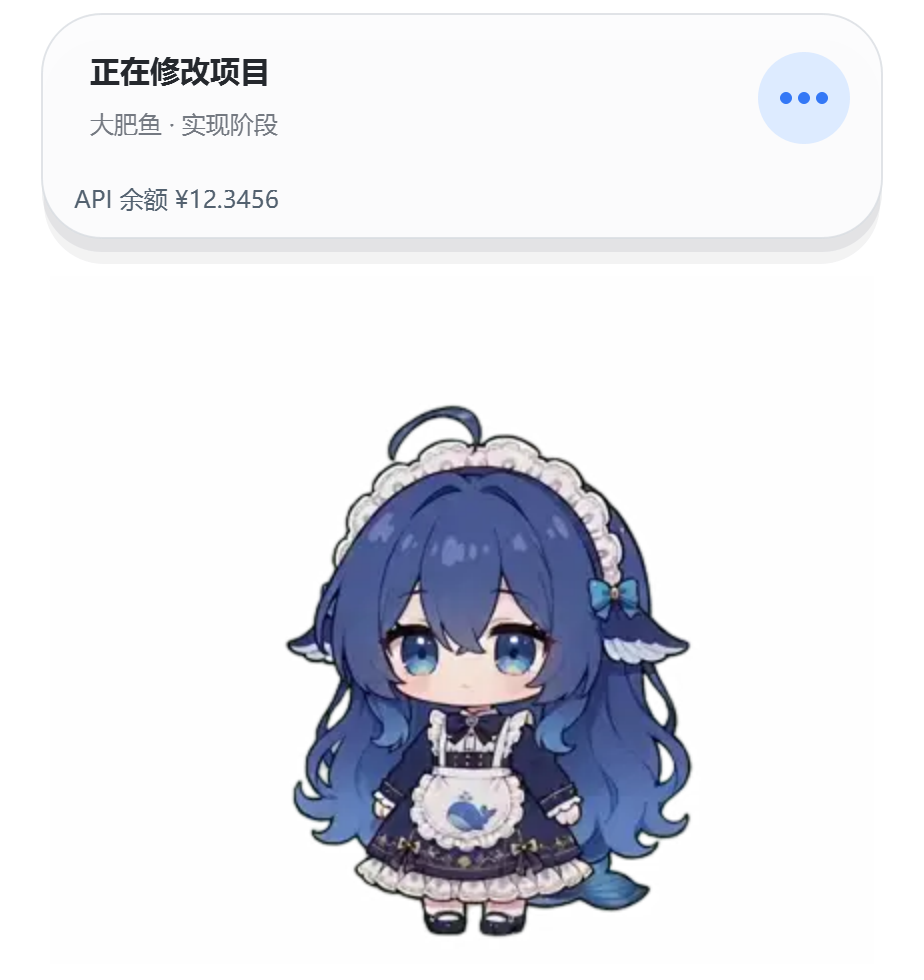

<div align="center">

# DSH 大肥鱼 · 金融版 🐋📈

**在桌面上陪你工作的 DeepSeek Harness 伴侣。** 这个 fork 让它跟着 A股 / 港股 / 美股 的涨跌喜怒哀乐。

[English](README_EN.md) · [上游项目](https://github.com/QCYTSN/dsh-dafeiyu) · [更新日志](CHANGELOG.md)

</div>

> **这是 [QCYTSN/dsh-dafeiyu](https://github.com/QCYTSN/dsh-dafeiyu) 的 fork（分支 `dsh-dafeiyu-jinrong`）。**
> 代码与原素材均为 MIT。上游的安装、打包与发布流程保持不变，本文只补充金融模式。
> **行情只做情绪反馈：不推荐、不建议、不预测、不背书。所有内容不构成投资建议。**

## 安装（和上游可以共存）

插件身份是独立的（包名 / 插件 id / 端点 / 设置命名空间都是 `dsh-dafeiyu-jinrong`），所以可以和上游
`dsh-dafeiyu` 装同一个 profile，两只鱼互不干扰。

**方式一：下载发布包（推荐）**

从 [Releases](https://github.com/zhing99-hash/dsh-dafeiyu-jinrong/releases/latest) 下载
`dsh-dafeiyu-jinrong-<version>.tgz`（不用解压），完全退出 DSH Host 后：

```powershell
dsh plugin --profile web add "C:\Users\<you>\Downloads\dsh-dafeiyu-jinrong-0.3.2.tgz"
```

> 本 fork **不发布到 npm**，所以 `dsh-dafeiyu-jinrong@0.3.2` 这种写法解析不到包，必须给文件路径。
> 官方桌面端用应用自带的 `dsh`：`<安装目录>\resources\runtime\cli\bin\dsh.cmd`。

> ⚠️ **升级前必须完全退出 DSH**（包括托盘）。DSH 运行时会占住 `node_modules`，
> pnpm 替换目录会报 `EPERM`，还可能把旧目录留成空的——重启后插件就"消失"了
> （设置页显示"尚未连接到 DSH Host"，接口 404）。
> 真遇到了：退出 DSH，在 profile 目录跑 `dsh plugin --profile desktop install`，再启动。

**方式二：自己打包**

```powershell
# 1) 打包（不发布）
pnpm pack --pack-destination .tmp

# 2) 装进某个 profile（完全退出该 profile 的 DSH Host 后执行）
dsh plugin --profile web add ".tmp\dsh-dafeiyu-jinrong-0.3.2.tgz"

# 3) 重启 DSH，设置页 → 行情情绪 → 启用
```

已实测的链路（独立 profile `jinrong-test`，2026-11-03）：

1. `dsh plugin add` 安装成功；
2. Host 启动，日志 `settings persistence (activation): namespace="dsh-dafeiyu-jinrong"`；
3. Helper `ready after 4302ms`（原生窗口气泡出现）；
4. 行情消息真的进了桌宠，`--event-log` 抓到：
   `{"kind":"state","phase":"market","stage":"A股 · 平静","message":"就这样吧，喝口水","detail":"-0.83% · 茅台 +0.19% · 腾讯 +1.73%↑"}`

## 养鱼模式（新增）

桌宠不再只跟随 DSH 任务，还可以跟着市场情绪走。

| 能力 | 说明 |
|---|---|
| 三个市场 | A股（上证指数 + 涨跌家数）、港股（恒生指数）、美股（道指 / 纳指），一个接口全拿 |
| 六档情绪 | 亢奋 / 乐观 / 平静 / 谨慎 / 恐慌 / 麻木，映射到宠物已有的 7 个状态，**不需要改 Qt/Python Helper** |
| 自选股 | 每只股票显示涨跌与强弱，可以设"高于多少 / 低于多少"提醒 |
| 价格提醒 | 阈值穿越才触发（不是站在线上就反复弹），同一只股票有冷却时间，多条同时触发会合并成一条气泡 |
| **Tab 切换视角** | 点一下桌宠取得焦点，Tab 在「总盘（沪深两市）→ 自选股 1 → 自选股 2 → …」循环，Shift+Tab 反向 |
| **Tushare（可选）** | 填 token 后用它取 A 股日线，算出真实量比参与个股情绪；不填/填错只影响量比，行情与提醒照常 |
| 状态仲裁 | 有 DSH 任务时任务优先，任务结束自动回到行情；提醒永远能弹出来 |
| 交易时段 | A股/港股/美股各自的时段与午休，美股夏令时用 `Intl` 按纽约时区算，不手写规则 |
| **大肥鱼工坊（0.4+）** | 左侧栏入口打开整页编辑器：可编辑气泡主题/内容、动作权重/点击池、表情包；预览由桌宠真机渲染 |

**开启方式**：设置页 → 养鱼 → 勾选"启用行情情绪"，选主市场，加自选股，填 Tushare token（可留空）。

**先看一眼效果**（不需要装插件，直接打真实行情）：

```powershell
node scripts/market-preview.mjs a            # 打印一条真实的情绪消息（a / hk / us）
node scripts/market-snapshot.mjs a           # 渲染总盘气泡到 .build/market-a.png
node scripts/market-snapshot.mjs a --view 1  # 渲染第一只自选股的气泡（等同按一次 Tab）
```

**气泡里显示什么**：第一行是情绪台词，第二行是 `指数涨跌 · 自选股1 · 自选股2`
（单行会被 elide，所以配了自选股时优先显示你自己的票；涨跌家数只在没有自选股时出现）。

**给配套面板的控制端点**（0.3.3+）：`GET /plugins/dsh-dafeiyu-jinrong/market-view`
返回当前视角和有序列表；`POST` 同一路径，body 用 `{"code":"sh603019"}`
（推荐，改自选股顺序也不会指错）或 `{"index":1}`，桌宠会立即切过去。
配套面板 `dsh-dafeiyu-stockpanel` 用它做 Tab 双向同步；没有这个端点时
面板会静默忽略，只做“跟随桌宠视角”的只读同步。
面板仓库：https://github.com/zhing99-hash/dsh-dafeiyu-stockpanel

### 大肥鱼工坊（0.4+）

左侧栏「大肥鱼工坊」打开一个整页编辑器：

- **气泡**：经典 / 手账 / 漫画 / 霓虹 / 玻璃五套主题，可调宽度、圆角、字体、
  颜色；场景由行和模块组成（文本 / 图标 / 图片 / 任务 / 分割线 / 留白），
  支持点击序列和随机台词。默认 spec 复刻旧白卡片，升级后外观不变。
- **预览**：由桌宠用同一个 `BubbleRenderer` 离屏渲染 PNG，编辑器里看到的就是
  桌宠真机效果，不是网页仿制。
- **动作**：新增 8 个 in-place 动作（悠闲哼歌、照镜子、摇扇纳凉、玩魔方、
  拆礼物、开心跃动、害羞惊讶、傲娇生气），共 24 个 clip；空闲动作分类权重、
  点击分区池、双击、睡觉/起来、右键动作菜单；动作与气泡配置保存在
  `$DSH_HOME/dafeiyu/`，升级不丢。帧按需加载（首帧预解码 + raw/decoded
  双 LRU），24 clip 不会在启动时全量驻留内存。
- **斗图**：优先使用已安装的 `dsh-meme` 只读图库；没装就用本地图库
  （PNG / GIF / WebP，单张 ≤ 8MB）。右键「斗图」来一张，点气泡换一张；
  聊天里出现 `[表情: …]` 或图片时桌宠只读回一张，不会往聊天里发消息。
  设置页「斗图反应」可关闭聊天回图，不影响右键手动斗图。
- **空闲天气与倒计时（0.5+）**：IDLE 时按 IP 显示 `城市：天气 26°C` 和最近
  每日目标倒计时；默认 `09:30 开盘`、`15:30 收盘`，可加 `17:00 下班` 等自定义
  目标。最后 10 秒优先覆盖气泡，到点播放「开心跃动」爱心提示。股票视角不叠加
  天气；任务进行时仍显示任务内容。
- **股票一行（0.5+）**：名称、股价、涨跌幅、量比在同一行，股价加粗放大；
  上限/下限只在破位时显示一个，上破红色、下破绿色。
- **动作包接口**：`assets/actions.json` 管分类/权重/点击池，`assets/pet-manifest.json`
  管 clip。后续扩展包按同一接口加 clip 即可，未知 clip 会被忽略。

> 0.4.0 的新气泡/斗图渲染在 Qt Helper（Windows / Linux）实现；macOS 的 Swift
> Helper 仍走旧卡片，等后续移植。
>
> 0.4.0 改了 Helper 的气泡/动作代码，源码 `link:` 安装前请先
> `npm run build:helper`（或直接用 Release 里已打包的 Helper）；只更新
> `src/` 和 `lib/` 不重建 Helper 时，桌宠仍会跑旧的气泡渲染器。


**排错：Helper 起不来 / 提示 "Could not create temporary directory"**
PyInstaller 打包的 Helper 启动前要把约 100 MB 解包到临时目录。某些 Windows 环境（受限 temp、
重定向 temp、或本机遇到的"C 盘不行、F 盘可以"）会让它解包失败，表现为宠物闪退。
可以指定一个可写目录：

```powershell
$env:DSH_DAFEIYU_TMP = 'D:\dsh-tmp'
```



*真实 A 股行情下的大肥鱼：第一行情绪，第二行指数涨跌与自选股强弱。*

**为什么不用音量因子**：指数行情的成交量单位与日 K 线不一致（报价 ~5.7e5、K 线 ~4e8），
比值是噪声，所以市场情绪只由涨跌幅、涨跌家数、振幅决定。个股仍保留量比。

大肥鱼由 DSH 插件启动，随 DSH 一起退出。透明、无边框、始终置顶的原生窗口，让你在编辑器、浏览器或其他应用中也能看到 Agent 的工作状态。

> **当前稳定版：0.1.23。** 修复 Linux arm64 / 无随架构 Helper 时 Python 回退未给出 PySide6 安装指引的问题；同时包含 0.1.22 的审批提示音与场景开关、0.1.21 的跨显示器拖动与菜单设置兜底、0.1.20 的透明区域点击穿透与 0.1.19 的 Helper 冷启动诊断。安装时填写 `dsh-dafeiyu@0.1.23`，离线安装请从[最新版下载页](https://github.com/QCYTSN/dsh-dafeiyu/releases/latest)选择 **`dsh-dafeiyu-0.1.23.tgz`**；Windows、Linux 与 macOS 共用这一个包。GitHub 自动生成的 **Source code (zip / tar.gz)** 是源码，不是安装包。



*原生 Windows 窗口实拍；余额为演示数据。当前角色素材来自 [PC2005-cloud/dsh-pet](https://github.com/PC2005-cloud/dsh-pet)。*

## 能做什么

- 显示真实任务状态：思考、查找、修改、执行、验证、等待确认、完成和错误。
- 展示项目、步骤、多任务和 DSH 提供的待办进度；没有真实进度时显示阶段。
- 在状态气泡和设置页显示 DeepSeek 余额，区分 API Key 与已登录账户。
- 兼容 WebUI 与官方桌面端的共享客户端；两个客户端使用各自的插件配置。
- 支持拖动、摸头、戳身体、碰尾巴，以及大小、气泡、声音和减少动态设置。
- 可选在 DSH 页面右下角显示轻量角色，默认关闭。

状态来自 DSH 会话事件。大肥鱼不会读取屏幕；推理强度与进度只显示上游实际提供的信息。

## 先选你的 DSH 客户端

| 使用方式 | 安装位置 | 设置入口（DSH 0.2） | 角色右键菜单的打开目标 |
| --- | --- | --- | --- |
| 浏览器 WebUI | `web` profile | 左侧插件 → dsh-dafeiyu | WebUI，默认 `http://127.0.0.1:3080/` |
| 官方桌面端 | `desktop` profile | 左侧插件 → dsh-dafeiyu | 通过 `dsh://open` 唤起桌面应用 |

**WebUI 中安装的插件不会自动出现在桌面端。** 两边都启用会各自启动原生角色，可以在其中一个 profile 关闭“大肥鱼”。第三方桌面包装器可能仍使用 `web` profile，请以它的实际启动方式为准。

客户端包中的 `platform: web` 也适用于官方桌面端：官方 Electron 应用使用同一套 Web 客户端。原生角色由对应 Host 启动。

## 安装

使用命令行安装、升级或移除前，先**完全退出对应 DSH Host**；操作后重新启动。通过桌面应用内的插件管理操作时，按应用提示重启。

### 浏览器 WebUI

已全局安装 DSH：

```powershell
dsh plugin --profile web add dsh-dafeiyu@0.1.23
dsh web
```

使用 `npx`，无需全局安装 DSH：

```powershell
npx -y @deepseek-ai/dsh plugin --profile web add dsh-dafeiyu@0.1.23
npx -y @deepseek-ai/dsh web
```

从 DeepSeek Harness 源码运行的用户，在 Harness 仓库中执行：

```powershell
pnpm dsh plugin --profile web add dsh-dafeiyu@0.1.23
pnpm dsh web
```

### 官方桌面端

推荐直接在应用内安装：

1. 打开官方 DeepSeek Harness 桌面应用，点击左侧 **插件**。
2. 点击 **添加插件**，输入 `dsh-dafeiyu@0.1.23`，点击 **安装**。
3. 安装成功后点击 **立即启用**，大肥鱼会出现在桌面上。
4. 在插件列表打开 **dsh-dafeiyu**，调整角色、气泡和余额设置，修改实时生效。

这套流程使用桌面应用自带的安装环境，用户无需安装 Node.js 或执行 npm 命令。若应用提示刷新或重启，按提示操作；失败时展开 **查看安装详情** 并保留日志。

也可以只填 `dsh-dafeiyu` 获取安装源中的最新版。新版本刚发布时，默认安装源可能仍返回旧版；指定版本可以避免装错。安装后核对详情页中的版本号。

使用命令安装时：

1. 先启动一次官方桌面应用，让它初始化 `desktop` profile，然后完全退出。
2. 使用桌面应用**自带的 `dsh` 命令**。支持命令注册的版本可从应用菜单的 **Manage dsh command… / 管理 dsh 命令**入口配置；也可直接调用安装目录的 `resources/runtime/cli/bin/dsh`（Windows 为 `dsh.cmd`）。
3. 执行：

   ```powershell
   dsh plugin --profile desktop add dsh-dafeiyu@0.1.23
   ```

4. 重新打开桌面应用，在左侧插件 → dsh-dafeiyu 调整角色。

**这里的 `dsh` 必须来自桌面应用。** 独立安装的 npm / `npx @deepseek-ai/dsh` CLI 不能修改官方桌面端的 profile。请参考 [DSH 官方桌面端说明](https://github.com/deepseek-ai/deepseek-harness/blob/master/apps/desktop/README.zh.md#bundled-command-runtime)。

### 使用 Release 安装包

打开[最新版下载页](https://github.com/QCYTSN/dsh-dafeiyu/releases/latest)，在 **Assets** 中下载 **`dsh-dafeiyu-0.1.23.tgz`**，用对应客户端的命令安装；**无需解压**。不要选择历史版本，也不要下载 **Source code** 作为安装包：

```powershell
# WebUI；文件路径替换为实际下载路径
npx -y @deepseek-ai/dsh plugin --profile web add "C:\Downloads\dsh-dafeiyu-0.1.23.tgz"

# 官方桌面端；必须使用应用自带的 dsh
dsh plugin --profile desktop add "C:\Downloads\dsh-dafeiyu-0.1.23.tgz"
```

桌面端也可在 **添加插件** 的输入框填写 `.tgz` 的完整路径。

## 余额显示

余额默认出现在**大肥鱼状态气泡底部和设置页**，查询逻辑由两个客户端共用。设置页可查看总余额、赠送和充值，并手动刷新。

| 来源 | 凭据来自哪里 | 查询内容 |
| --- | --- | --- |
| 自动（默认） | 优先使用 DSH 模型设置中的 DeepSeek API Key；未配置时尝试已登录账户 | 对应来源的余额 |
| API Key | DSH 的凭据服务；旧 Host 无该服务时读取启动环境 | DeepSeek `/user/balance` |
| 已登录账户 | DSH 的 DeepSeek 账户服务 | 账户充值与赠送钱包 |

- 在 **DSH 模型／账户设置**中配置凭据；大肥鱼设置页不需要再填写 API Key。
- API 余额与账户余额分别标明来源；CNY / USD 分别显示。
- 每分钟自动刷新，同一 Host 内共享缓存；手动刷新最快每 5 秒一次。
- 服务失败时保留上次成功结果，并标明“上次查询”；未配置、授权失败和网络失败分别提示。
- 自定义网关需要实现相同的 `/user/balance` 接口；不支持时显示查询失败。
- API Key、登录凭据和上游原始错误不会进入余额页面、角色消息或事件流。
- 没有余额凭据也能正常显示任务状态；可关闭“显示 DeepSeek 余额”。

账户余额和 API 余额的查询方式参考了 [keshing/balance-display](https://github.com/keshing/balance-display) 与 DSH 的公开账户服务。插件不会发起模型调用。

## 常用设置

| 设置 | 作用 |
| --- | --- |
| 启用大肥鱼 | 开关当前 profile 的原生角色 |
| 角色大小 / 气泡大小 | 独立调整；小气泡保留基本字号 |
| 安静 / 标准 / 活泼 | 每次待机动作结束后，分别休息 45～90 / 25～45 / 12～22 秒 |
| 减少动态 | 固定角色姿势，停止待机与点击动画；状态和提示仍实时更新 |
| 提示音 | 所有提示的总开关（只影响声音） |
| 提示音与通知场景 | 分别开启“对话完成”“工具出错”“等待审批”提示。取消后该场景不再播放声音；macOS 同时不再弹系统通知横幅，Windows / Linux 只播放声音 |
| 气泡显示 | 常驻、隐藏，或仅在指定状态显示 |
| 子 Agent | 允许子 Agent 状态参与显示 |
| 页面内角色 | 在 DSH 页面右下角显示轻量角色 |
| 打开目标 | 自动、WebUI 或官方桌面端 |
| 显示余额 / 余额来源 | 开关与选择余额查询来源 |

设置页修改实时生效。右键菜单可调整大小、减少动态、打开对应 DSH 客户端，或仅在本次运行隐藏／关闭角色。

点击动作会完整播完，再回到当前任务状态；新任务可立即打断装饰动作。拖拽期间只播放悬空姿势，松手后完整落地。具体触发、频率和衔接规则见 [动作说明](docs/animation-behavior.md)。

若 WebUI 使用自定义地址，可在启动 Host 时设置 `DSH_DAFEIYU_WEBUI_URL`；它优先于自动推断的默认地址。

## 平台与运行环境

| 平台 | 原生角色 |
| --- | --- |
| Windows 10 / 11 x64 | 随包提供 Helper；WSL2 可通过 Windows 互操作启动 |
| Linux x64 | 随包提供 Qt Helper，需要图形桌面；glibc 2.35+，Ubuntu 24.04 有验收记录 |
| Linux arm64 | 包里**没有**随架构 Helper，会自动回退到 Python Helper，需要 `python3` 与 `PySide6>=6.7,<7`；缺失时会写明确日志 |
| macOS 12+ | 原生 Swift / AppKit Helper，Universal 构建；实验性支持 |

标准安装包已包含 Helper，**不需要自己安装 Python 或运行 Helper**。从源码使用时需自行构建。macOS 小字号与拖动边缘已修复并通过 CI，仍需真实机器验证视觉效果与多屏操作。

原生角色显示在 **Host 所在的桌面**：远程服务器、无图形环境和浏览器客户端不在同一台机器时，请先确认 Host 的运行位置。页面内角色可在浏览器中显示。

## 更新与排错

WebUI 用户完全退出 DSH 后执行：

```powershell
npx -y @deepseek-ai/dsh plugin --profile web update dsh-dafeiyu
```

官方桌面端 **0.2.0-rc.2 暂不支持应用内自动更新**。在插件页面卸载大肥鱼，再添加 `dsh-dafeiyu@0.1.23` 并立即启用；也可以完全退出应用后使用自带的命令：

```powershell
dsh plugin --profile desktop update dsh-dafeiyu
```

然后重新启动对应客户端。回退、移除、DSH 迁移后恢复大小，以及 Windows `EPERM` 的处理见 [更新与回退](docs/UPDATING.md)。

- DSH 0.2 设置页变化：安装当前稳定版，通过左侧插件 → dsh-dafeiyu 打开设置；较旧 Host 保留原设置入口。
- 桌面端安装只显示 `[exit 1]`：该信息不足以确定原因，请附上插件安装详细日志（如 `hub.log`）、DSH 版本、系统和安装方式。
- 余额查询失败：检查 DSH 中的凭据及所用网关是否支持余额接口。
- 角色不出现：检查 profile、插件是否启用，以及 Host 是否有可用图形桌面。Helper 的启动原因现在会写入日志：
  - Windows：`%LOCALAPPDATA%\dsh-dafeiyu\logs\helper.log`
  - macOS：`~/Library/Logs/dsh-dafeiyu/helper.log`
  - Linux：`${XDG_STATE_HOME:-~/.local/state}/dsh-dafeiyu/helper.log`

  首次启动需要把约 100 MB 的 Qt 运行库解压到临时目录，杀毒软件实时扫描可能让冷启动明显变慢；首次就绪等待上限已放宽到 180 秒（之后 60 秒）。解压临时目录在 Windows 位于 `%LOCALAPPDATA%\dsh-dafeiyu\tmp`、Linux 位于 `~/.cache/dsh-dafeiyu/tmp`，其中超过一天的陈旧 `_MEI*` 目录会在下次启动时清理。需要更详细输出时可用 `DSH_DAFEIYU_LOG_FILE=<路径>` 改日志位置，或设为 `off` 关闭；报告问题时可以附上该日志（只含本地路径与启动错误，不含凭据）。

[GitHub issue / PR 处理清单](https://github.com/QCYTSN/dsh-dafeiyu/blob/main/docs/GITHUB_TRIAGE.md)记录已处理和仍需补充证据的问题；[验收记录](https://github.com/QCYTSN/dsh-dafeiyu/blob/main/docs/ACCEPTANCE.md)保留实际测试结果。这些记录中的旧版本号用于追溯，不是安装建议。

## 源码开发

```powershell
pnpm install --frozen-lockfile
npm test
npm run test:python
npm run build:helper
npm run test:helper:packaged
```

开发 Python Helper 需要 `requirements.txt` 中的依赖；macOS Helper 需要 Xcode Command Line Tools。纯 Swift 核心测试运行 `swift test`。修改原生代码后应重新构建 Helper，再安装本地打包产物。

CI 还会隔离安装 DSH 0.2.0-rc.2 并运行 `scripts/test-dsh-settings.mjs`，验证新设置接口。该检查不读取用户 profile 或凭据，文件写入使用测试适配器。

项目通过 GitHub Actions 构建三个平台的 Helper 并发布；维护者操作见 [发布说明](https://github.com/QCYTSN/dsh-dafeiyu/blob/main/docs/RELEASING.md)。

## 素材与授权

当前动态素材来自 [PC2005-cloud/dsh-pet](https://github.com/PC2005-cloud/dsh-pet)，以来源的 **24 fps** 转成透明 WebP 帧。当前清单含 24 组动作、5,372 帧，帧画布为 412 × 344；清单记录了上游版本、视频校验值和取帧范围。

软件代码与角色素材适用不同授权，请完整阅读 [ASSET_LICENSE.md](ASSET_LICENSE.md)、[素材来源许可证](assets/dsh-pet-LICENSE.txt)和 [LICENSE](LICENSE)。旧版素材及社区拖拽图片保留于 `legacy/`，不随当前 npm 包分发。

感谢社区在动画、macOS、WSL 和兼容性方面的贡献。想接收更新通知，请订阅仓库 **Watch → Custom → Releases**；Star 只收藏项目。
